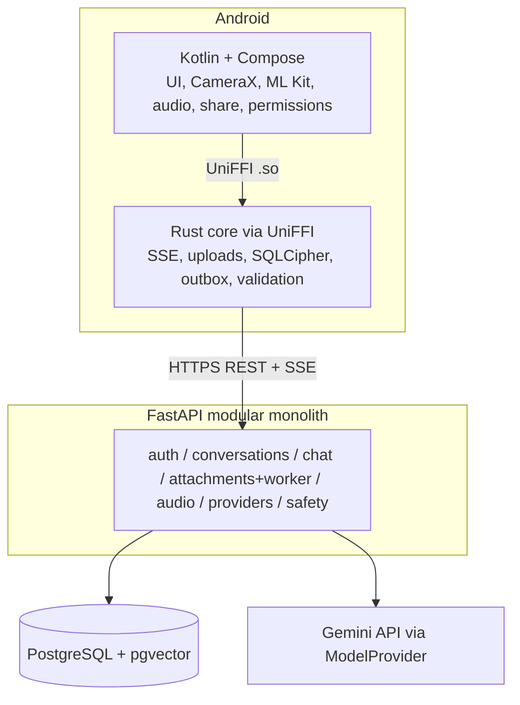
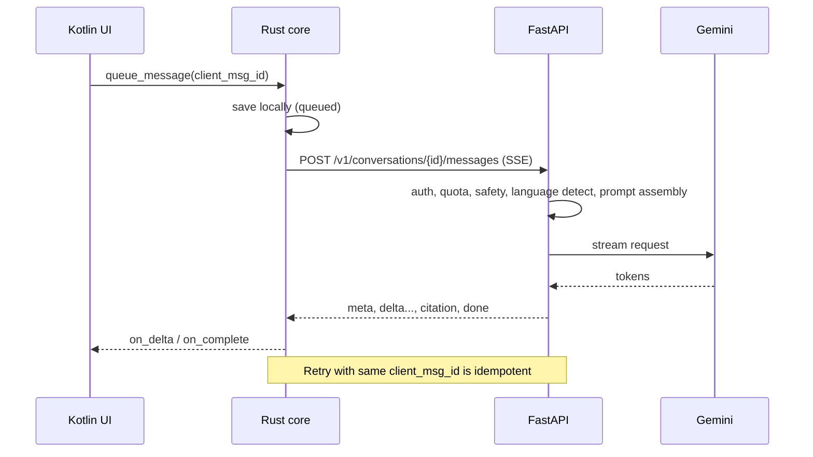
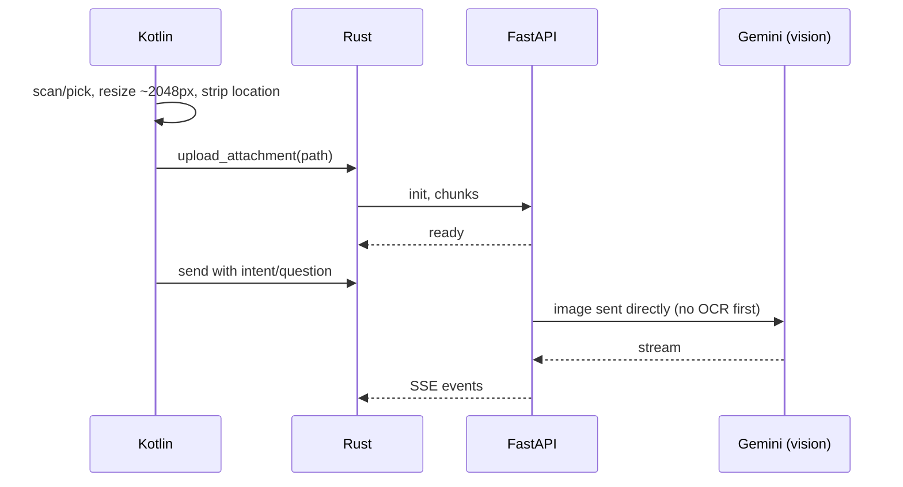
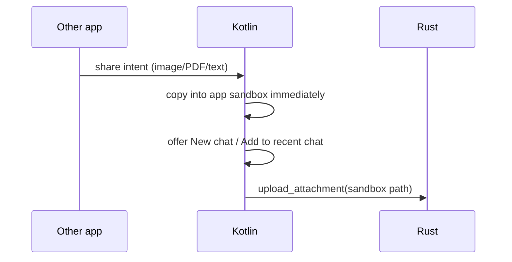
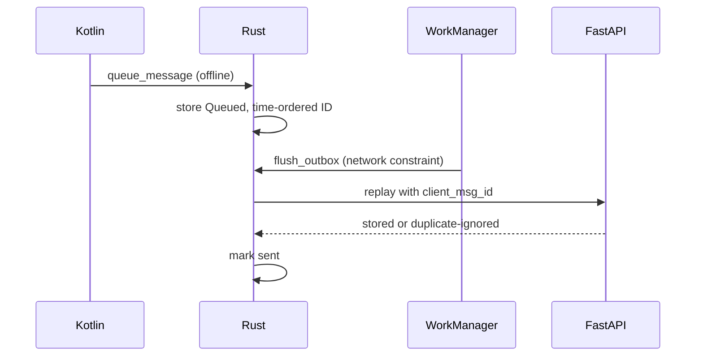

# Architecture

- **Purpose:** Describe the system, the Kotlin/Rust/Python boundaries and the key end-to-end flows.
- **Audience:** Engineers and agents.
- **Status:** Draft
- **Last updated:** 2026-11-23
- **Related docs:** [RUST_CORE](RUST_CORE.md), [API_CONTRACT](API_CONTRACT.md), [DATA_MODEL](DATA_MODEL.md), [AI_PIPELINE](AI_PIPELINE.md), [FOLDER_STRUCTURE](FOLDER_STRUCTURE.md)

## System overview [v1]
Three tiers: Android client (Kotlin + Compose over a headless Rust core), FastAPI modular monolith, and PostgreSQL + pgvector with the Gemini API behind `ModelProvider`.



## Boundaries
| Layer | Owns | Never does |
|---|---|---|
| Kotlin | Compose UI, navigation, CameraX, ML Kit scanner, pickers, audio record/playback, permissions, share intents, image resize and EXIF strip | Network streaming, DB access |
| Rust core | SSE client and reconnect, resumable uploader and hashing, SQLCipher store, outbox, client validation | Android lifecycle, content URIs, Compose state |
| FastAPI | Auth, conversations, chat orchestration, extraction worker, transcription, provider calls, safety, quotas | Trust client input; expose the provider key |

Details: [ANDROID_CLIENT](ANDROID_CLIENT.md), [RUST_CORE](RUST_CORE.md), [AI_PIPELINE](AI_PIPELINE.md).

## Flow 1: streaming chat [v1]


## Flow 2: image question [v1]


## Flow 3: file extraction [v1]
```mermaid
sequenceDiagram
  participant RC as Rust
  participant API as FastAPI
  participant W as Job worker
  participant DB as Postgres
  RC->>API: init + chunks
  API->>API: verify type by header, size caps
  API->>DB: job row (queued)
  W->>DB: claim job (row lock, heartbeat)
  W->>W: extract text/tables; vision OCR only for scanned pages
  W->>DB: extracted_content; chunks + embeddings if long
  W->>DB: purge raw chunks, status ready
  API-->>RC: attachment events SSE: ready
```

## Flow 4: voice with review [v1]
```mermaid
sequenceDiagram
  participant UI as Kotlin
  participant RC as Rust
  participant API as FastAPI
  UI->>UI: record 16 kHz mono to file
  UI->>RC: upload audio
  RC->>API: POST /v1/audio/transcribe
  API-->>RC: transcript, language, confidence
  RC-->>UI: result
  UI->>UI: fill composer; warn if low confidence
  Note over UI: User edits, then taps Send. Never auto-send.
```

## Flow 5: share intake [v1]


## Flow 6: offline outbox sync [v1]


## Cross-cutting
Safety and injection isolation: [AI_PIPELINE](AI_PIPELINE.md), [SECURITY_PRIVACY](SECURITY_PRIVACY.md). Contracts: [API_CONTRACT](API_CONTRACT.md). Gateway-ready contracts mean a v2 gateway could be added without client changes ([ADR-0003](decisions/ADR-0003-fastapi-only-backend.md)).
